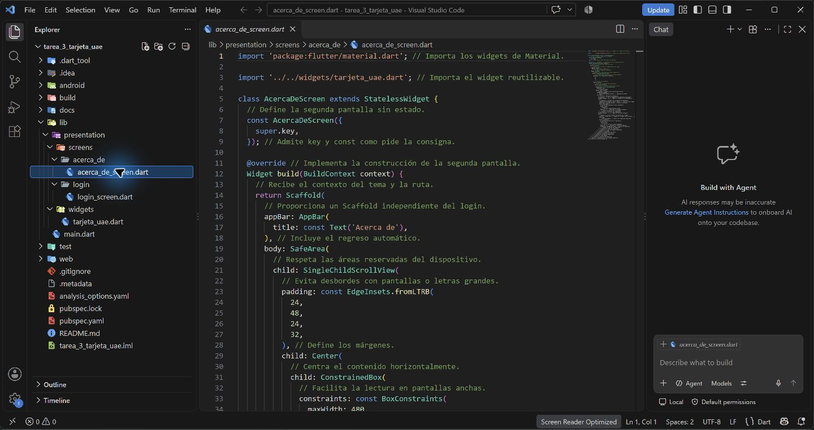
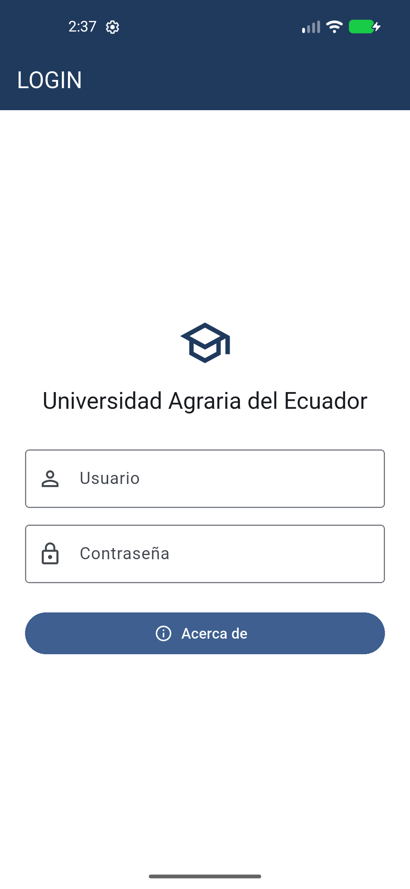
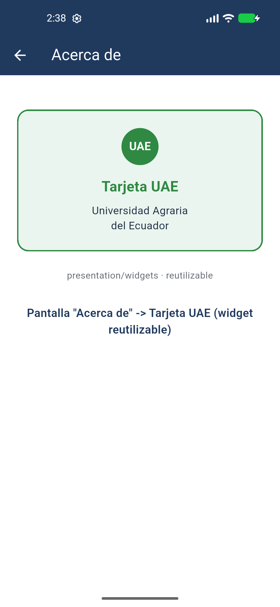

# Tarjeta UAE

Tarea asíncrona #3 · Semana 6 · Lenguaje de Programación 5 · Sexto semestre · Universidad Agraria del Ecuador.

Aplicación Flutter basada en el `LOGIN` trabajado en clase. Añade la pantalla **Acerca de**, una tarjeta personalizada reutilizable y el resultado solicitado en la consigna. El código de la aplicación y las pruebas incluyen comentarios por línea para explicar su funcionamiento.

## Integrantes del grupo

**Paralelo 6SB · Grupo 6**

1. Luna Peñafiel Romina
2. Pérez Abad Evelyn
3. Saa Chichande Solange
4. Sanaguaray Gusqui Jorge
5. Solís Calderón Dayanna

## Funcionamiento

1. Al iniciar se muestra **LOGIN**, con los campos **Usuario** y **Contraseña** del ejemplo de clase. La contraseña aparece oculta. Este formulario es una base visual y no implementa autenticación.
2. Pulsa **Acerca de** para abrir la segunda pantalla. La navegación utiliza `Navigator.push` y `MaterialPageRoute`.
3. La pantalla muestra el widget **Tarjeta UAE**, con las siglas de la universidad, el título y la descripción.
4. Debajo aparece el siguiente resultado mediante un widget `Text`:

```text
Pantalla "Acerca de" -> Tarjeta UAE (widget reutilizable)
```

La flecha de la barra superior permite regresar a **LOGIN**. Ambas pantallas permiten desplazarse cuando el espacio disponible se reduce o aumenta el tamaño del texto.

## Estructura del proyecto

Flutter no impone una organización específica de carpetas dentro de `lib`, porque permite adaptar el código al tamaño y las necesidades de cada aplicación. En este proyecto se eligió una capa `presentation`, con las pantallas agrupadas por funcionalidad dentro de `screens/login` y `screens/acerca_de`, y los componentes compartidos dentro de `widgets`. Así, `main.dart` se encarga del arranque y del tema, cada pantalla mantiene su propia interfaz y la tarjeta puede reutilizarse sin duplicar código; esta separación facilita comprender el proyecto y ampliarlo con nuevas funcionalidades.

```text
tarea_3_tarjeta_uae/
├── lib/
│   ├── main.dart
│   └── presentation/
│       ├── screens/
│       │   ├── login/
│       │   │   └── login_screen.dart
│       │   └── acerca_de/
│       │       └── acerca_de_screen.dart
│       └── widgets/
│           └── tarjeta_uae.dart
├── test/
│   └── widget_test.dart
├── docs/
│   └── capturas/
│       ├── arbol-carpetas.jpg
│       ├── login.png
│       └── acerca-de.png
├── android/
├── web/
├── analysis_options.yaml
├── pubspec.yaml
├── pubspec.lock
└── README.md
```



| Archivo | Responsabilidad |
| --- | --- |
| [lib/main.dart](lib/main.dart) | Ejecuta `MyApp`, configura `MaterialApp` y comparte el tema de la aplicación. |
| [login_screen.dart](lib/presentation/screens/login/login_screen.dart) | Conserva el formulario de clase y añade el botón para navegar a **Acerca de**. |
| [acerca_de_screen.dart](lib/presentation/screens/acerca_de/acerca_de_screen.dart) | Define la segunda pantalla como `StatelessWidget`, con constructor `const`, `super.key` y su propio `Scaffold`. Utiliza la tarjeta y muestra el resultado exacto. |
| [tarjeta_uae.dart](lib/presentation/widgets/tarjeta_uae.dart) | Define `TarjetaUae`, un `StatelessWidget` con constructor `const`, `super.key` y parámetros `titulo` y `descripcion` para reutilizarlo con otros contenidos. |
| [test/widget_test.dart](test/widget_test.dart) | Comprueba navegación, campos, reutilización de la tarjeta y adaptación a pantallas estrechas con texto ampliado. |

## Capturas de la aplicación en Android

| Pantalla inicial | Segunda pantalla y resultado |
| --- | --- |
|  |  |

## Ejecutar el proyecto

El proyecto incluye las plataformas **Android** y **web**. Se preparó con **Flutter 3.47.7** y **Dart 3.13.5**. Abre esta carpeta en Android Studio o Visual Studio Code con los complementos de Flutter y Dart.

Desde la raíz del proyecto, descarga las dependencias:

```sh
flutter pub get
```

Para Android, inicia un emulador o conecta un dispositivo con depuración USB. Consulta los dispositivos disponibles y ejecuta la aplicación:

```sh
flutter devices
flutter run
```

Si aparece más de un dispositivo, utiliza `flutter run -d ID_DEL_DISPOSITIVO`, sustituyendo el identificador por el que muestra `flutter devices`.

Para ejecutar la versión web en Chrome:

```sh
flutter run -d chrome
```

## Verificación

```sh
flutter analyze
flutter test
```

El análisis estático terminó sin incidencias y las **4 pruebas de widgets** pasaron:

- Apertura de **Acerca de**, presencia de la tarjeta y del resultado exacto, y regreso a **LOGIN**.
- Presencia de los campos originales y ocultación de la contraseña.
- Reutilización de `TarjetaUae` con título, descripción y clave personalizados.
- Navegación y contenido sin desbordamientos en una pantalla de 320 × 568 píxeles lógicos con el texto ampliado al doble.

También se compiló el APK de depuración con `flutter build apk --debug`, se instaló y se ejecutó en el emulador **Pixel 5 con Android 17 (API 37)**. Las capturas anteriores corresponden a esa ejecución; la consulta del registro de errores de Flutter no mostró errores.
